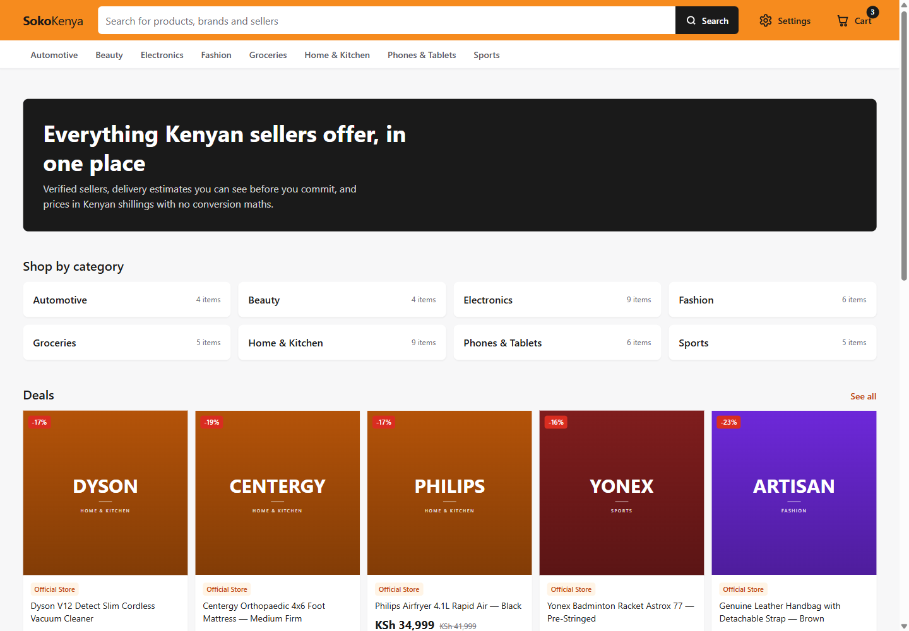
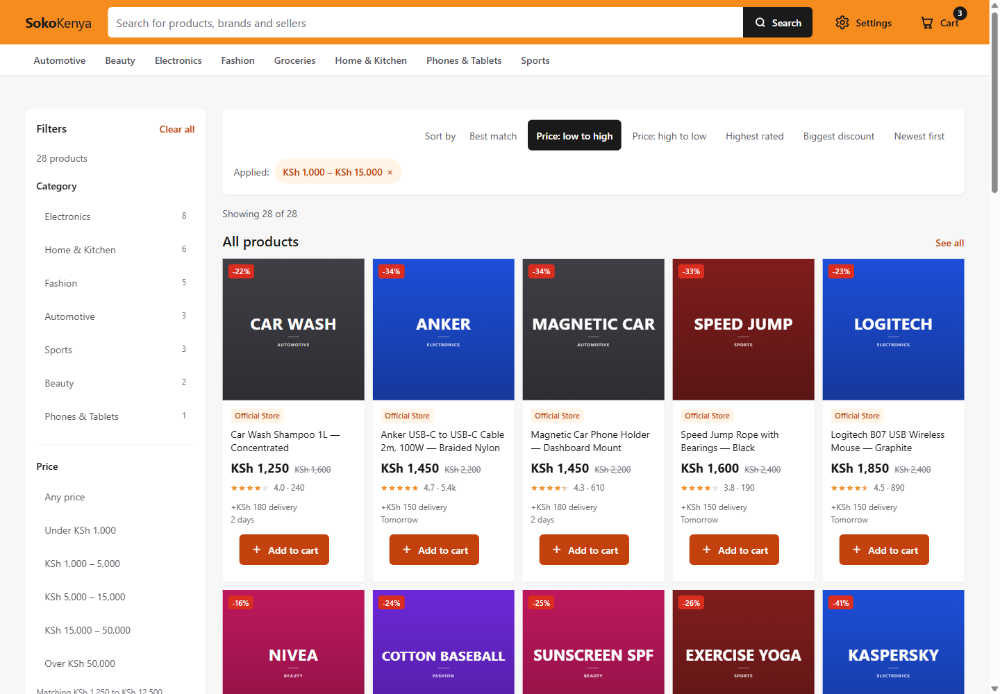
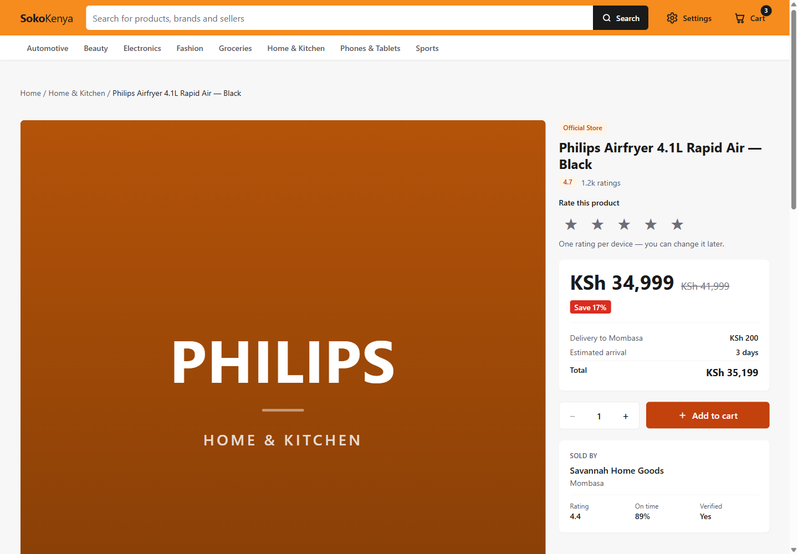
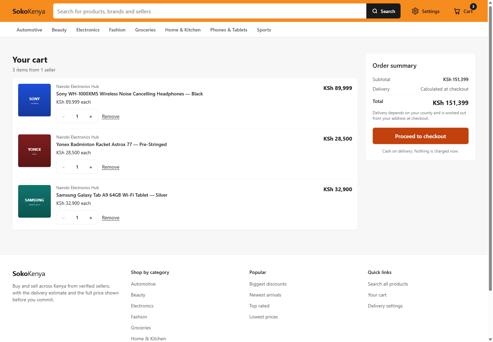
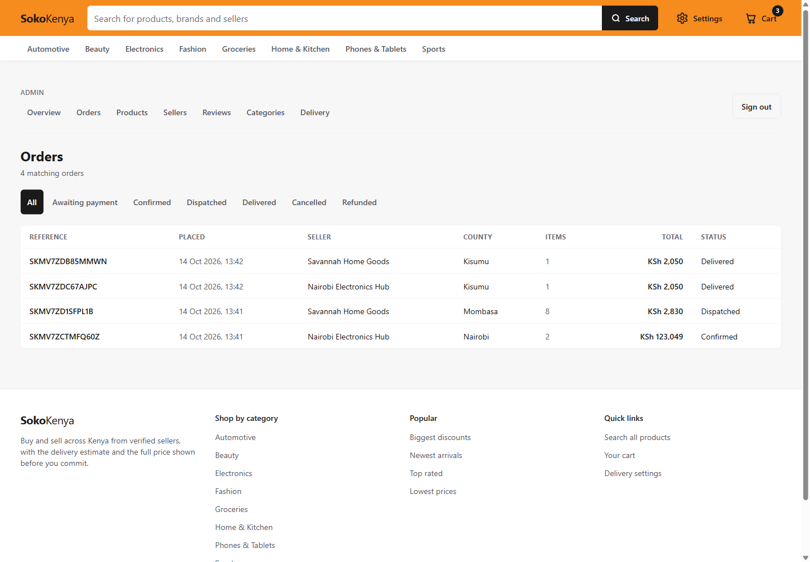
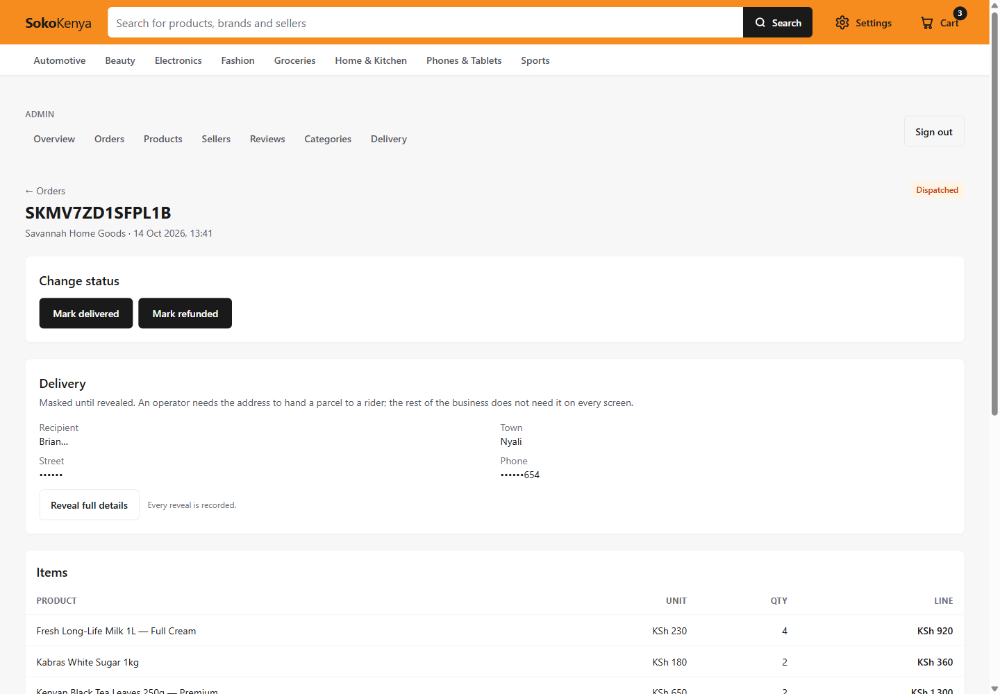
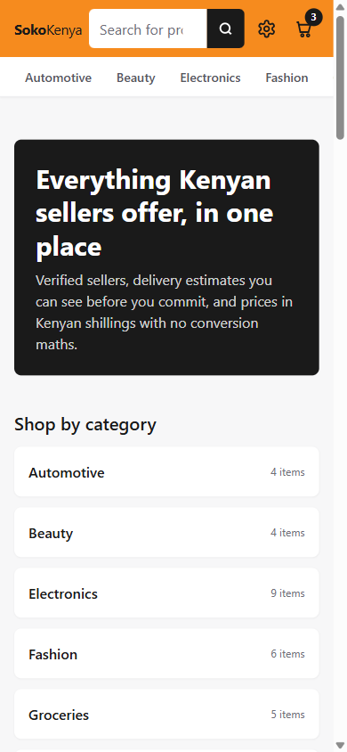

# SokoKenya

A marketplace for Kenyan small shops, built around how the market actually
buys: **cash on delivery, no account, phone-first**.

The hard parts of this project are not the catalogue. They are stock that cannot
be oversold by two people clicking Buy at once, an admin console that can
moderate the marketplace without leaking a customer's address to the next person
who logs in, and a storefront that stays *correct* while those decisions are
being made — not correct at the moment the query was written.

> **Status:** complete and tested — 15 test suites, all passing. Payment is cash
> on delivery only; M-Pesa is not wired up. See [Not done](#not-done).

## Screenshots

| Home | Catalogue | Product |
| --- | --- | --- |
|  |  |  |

| Cart | Admin console | Order detail |
| --- | --- | --- |
|  |  |  |

The order-detail shot is the one worth looking at. The customer's street and
phone are masked when the page renders; the button that unmasks them says
*"Every reveal is recorded"*, because it is.

<p align="center">
  
</p>

## What it does

**For a shopper** — browse and filter a real catalogue, read a product with its
seller and delivery estimate, add to a cart, and check out with cash on
delivery. No account to create, no card to enter. An order is tracked by its
reference.

**For the operator** — a back office behind a shared-secret sign-in:

- Orders with a legal state machine (transitions enforced in SQL inside a
  locked transaction, not in the UI)
- Product editing and archiving, with validation that runs *inside* the same
  lock
- Seller moderation — verify, suspend with a required reason, reinstate
- Review moderation, with the deleted text preserved in the audit log
- Category and delivery-area management

## The three problems worth reading about

### 1. Stock cannot be oversold

Two shoppers can reach the last unit at the same moment. Adding to cart takes a
**30-minute hold** on a unit, refreshed on every add, and the count a shopper
sees everywhere — card, quantity stepper, "only N left" — is
`stock - stock_reserved`, never `stock`. Stock already promised to another
cart cannot be promised twice.

Cancelling an order returns stock exactly once, and never touches the held
count, because the two numbers have separate jobs.

### 2. A moderation action must not leak the next person's data

Suspending a seller is one column. Reinstatement is therefore exact — there is
nothing to reverse, because nothing was copied.

But that one column is read by **three different query shapes**, and missing it
in any one of them is a silent lie: the header would say 48 products while the
list showed 41. So it is enforced in the shared product fragment, in the
filter query's own count/facet joins, and in the two category-count subqueries
that join products with no seller join at all.

A basket assembled *before* a suspension is the case that breaks naive
implementations — checkout re-checks every line at commit time and refuses
anything no longer sellable.

### 3. Customer details are masked until somebody has a reason

Orders contain a real name, phone, town and street. The console renders them
masked. Revealing one is a **server action that writes an audit row before it
returns the data**, so "who looked at this customer's address, and when" has an
answer.

No seller's phone number appears on any admin screen at all — audited or not —
which keeps the rule blunt enough to hold.

## Stack

| | |
| --- | --- |
| Framework | Next.js 16.4 (App Router), React 19 |
| Language | TypeScript (strict) |
| Styling | Tailwind CSS v4 |
| Database | PostgreSQL on Neon, via Drizzle ORM + `pg` |
| Migrations | 10 numbered SQL migrations, applied in order |

## Running it

Requires Node 20+ and a Neon Postgres connection.

```bash
npm install

# .env.local — never committed
#   DATABASE_URL=postgres://...            (pooled)
#   DATABASE_URL_UNPOOLED=postgres://...   (DDL and migrations)
#   ADMIN_PASSWORD=...
#   ADMIN_SESSION_SECRET=<64 random chars>

npm run db:migrate     # apply migrations in order
npm run db:seed        # sample catalogue, sellers, categories, counties
npm run db:seed:orders # a few real orders, so the admin console isn't empty
npm run db:images      # generate the product artwork
npm run dev            # http://localhost:3000
```

`db:seed:orders` calls the **real** `placeOrder()`, so the demo orders are
exactly what a shopper would have produced — same rows, same lines, same status
history. It is how the screenshots above were made.

`DATABASE_URL` is the **pooled** URL and is used for all application traffic.
Migrations deliberately use the unpooled one, because a transaction-mode proxy
can hand two statements in one transaction to two different backends.

## Tests

```bash
npm test                       # 12 suites, no server needed
npm run dev                    # in another shell
SMOKE_BASE_URL=http://localhost:3000 npm test -- --http   # all 15
```

The suites run against the real database and the real code paths — the
reservation-race test fires concurrent buyers at the last units; the checkout
suite calls the actual `placeOrder` rather than a mock; the moderation suite
drives every public product read path three times (seller active, suspended,
reinstated) so "suspending a seller hides their catalogue" is asserted against
the queries rather than restated as SQL.

```
✓ migration bookkeeping   ✓ cart behaviour        ✓ moderation
✓ schema sync             ✓ checkout conversion   ✓ filters (HTTP)
✓ schema constraints      ✓ placeOrder (real)     ✓ checkout surface (HTTP)
✓ cart schema             ✓ reservation race      ✓ admin guard (HTTP)
✓ ratings
✓ admin auth + order rules
✓ catalogue editing
```

## Documentation

[`docs/`](./docs) holds the working documentation — written as the work
happened, not afterwards.

| | |
| --- | --- |
| [pages.md](./docs/pages.md) | Every route, what it is for, what it links to, and the 11 still planned |
| [interactions.md](./docs/interactions.md) | What happens when a control is pressed — component, action, SQL |
| [imagery.md](./docs/imagery.md) | Where product images come from, and why the DB stores a key not a URL |
| [admin.md](./docs/admin.md) | The console's auth model, its rules, and its deliberate omissions |

## Not done

Listed plainly, because a README that only lists successes is a sales page:

- **No M-Pesa.** Checkout is hardcoded to `paymentMethod: "cod"`.
- **No shopper accounts.** Orders are retrieved by reference, which is
  genuinely how most of this market works — but it means no order history and
  no saved addresses.
- **The admin console has one shared password.** Appropriate for a
  single-operator back office, wrong for a team: there are no per-person
  accounts, so the audit log records *that* something happened, not *who by name*.
- **No product or seller self-service.** Rows arrive from the seed script; the
  console edits and moderates what exists.
- **Moderation lists do not paginate.** Sellers and reviews stop at 100 rows
  without saying so.
- **Review deletion is permanent** — recoverable only from the audit log, by
  hand.
- **No CI.** The 15 suites run locally; nothing runs them on push yet.

## Licence

Private work. No licence granted.
